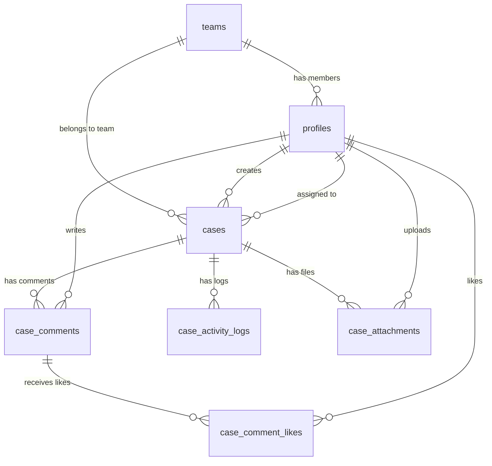

# Phase 2.1: Case Management Database Schema Design & Audit — DevCase

รายงานการตรวจสอบสถาปัตยกรรม Case Management ในปัจจุบันและการออกแบบ Supabase PostgreSQL Database Schema สำหรับการย้ายระบบจาก Mock Data สู่ฐานข้อมูลจริง

---

## A. Current Architecture (สถาปัตยกรรมระบบเคสปัจจุบัน)

- **Models**:
  - `CaseModel`: จัดเก็บรายละเอียดเคส เช่น `id` (`DEV-001`), `title`, `priority` (`CasePriority`), `status` (`CaseStatus`), `team` (`TeamType`), `category`, `assignee` (`UserModel`), `dateText`, `systemAffected`, `environment`, `url`, `browser`, `createdById`, `attachedImages`, `attachedFiles`, `comments`, `activityLogs`.
  - `CommentModel`: ความคิดเห็นในเคส รองรับ `id`, `caseId`, `author` (`UserModel`), `content`, `dateText`, `attachedImageUrl`, `likes`, `isLiked`.
  - `ActivityLogModel`: บันทึกประวัติกิจกรรมในเคส เช่น สร้างเคส, เปลี่ยนสถานะ, มอบหมายงาน, คอมเมนต์, แนบไฟล์ (`id`, `caseId`, `title`, `authorName`, `dateText`, `icon`, `iconColor`, `iconBgColor`).
  - `CaseFileAttachment`: ชื่อและขนาดไฟล์แนบ (`fileName`, `fileSize`).
- **CRUD & Workflow**:
  - ดำเนินการผ่าน `AppState` โดยแก้ไข List ในหน่วยความจำ (`cases`) โดยตรง
  - รองรับการสร้างเคสใหม่ (`createCase`), แก้ไขรายละเอียด (`updateCaseDetails`), เปลี่ยนสถานะ (`updateCaseStatus`), เปลี่ยนความสำคัญ (`changeCasePriority`), เปลี่ยนทีม (`changeCaseTeam`), มอบหมายผู้รับผิดชอบ (`reassignCase`), เพิ่มความคิดเห็น (`addComment`), และกดไลค์คอมเมนต์ (`toggleLikeComment`).
- **Permissions & Access Control**:
  - ควบคุมผ่าน `RolePermissionHelper` และ `Role` ของผู้ใช้ (`Admin`, `TeamLead`, `Developer`, `User`) พร้อมข้อกำหนดการมองเห็นเคสตาม Role, ทีม, และการมีส่วนร่วมในเคส

---

## B. Proposed Database Tables (การออกแบบตารางฐานข้อมูล PostgreSQL)

ใช้ตาราง `profiles` และ `teams` ที่มีอยู่แล้วในระบบ โดยออกแบบตารางใหม่สำหรับ Case Management ดังนี้:

### 1. `cases` (ตารางหลักเก็บข้อมูลเคส)
- `id`: `uuid` (PK, DEFAULT gen_random_uuid())
- `case_no`: `text` (UNIQUE, เช่น `DEV-001`, ใช้แสดงผลมนุษย์)
- `title`: `text` (NOT NULL)
- `priority`: `text` (NOT NULL, CHECK (priority IN ('low', 'medium', 'high', 'critical')))
- `status`: `text` (NOT NULL, CHECK (status IN ('open', 'assigned', 'inProgress', 'pending', 'waiting', 'testing', 'done', 'closed')))
- `team_id`: `uuid` (FK REFERENCES teams(id), NOT NULL)
- `category`: `text` (NOT NULL)
- `assignee_id`: `uuid` (FK REFERENCES profiles(id), NULLABLE)
- `system_affected`: `text` (NULLABLE)
- `environment`: `text` (NULLABLE)
- `url`: `text` (NULLABLE)
- `browser`: `text` (NULLABLE)
- `created_by`: `uuid` (FK REFERENCES profiles(id), NOT NULL)
- `created_at`: `timestamptz` (DEFAULT clock_timestamp())
- `updated_at`: `timestamptz` (DEFAULT clock_timestamp())

### 2. `case_comments` (ตารางเก็บความคิดเห็น)
- `id`: `uuid` (PK, DEFAULT gen_random_uuid())
- `case_id`: `uuid` (FK REFERENCES cases(id) ON DELETE CASCADE, NOT NULL)
- `author_id`: `uuid` (FK REFERENCES profiles(id), NOT NULL)
- `content`: `text` (NOT NULL)
- `attached_image_url`: `text` (NULLABLE)
- `created_at`: `timestamptz` (DEFAULT clock_timestamp())

### 3. `case_comment_likes` (ตารางติดตามการกด Like คอมเมนต์ เพื่อป้องกันการกดซ้ำ)
- `comment_id`: `uuid` (FK REFERENCES case_comments(id) ON DELETE CASCADE, NOT NULL)
- `user_id`: `uuid` (FK REFERENCES profiles(id) ON DELETE CASCADE, NOT NULL)
- `created_at`: `timestamptz` (DEFAULT clock_timestamp())
- PRIMARY KEY (`comment_id`, `user_id`)

### 4. `case_activity_logs` (ตารางบันทึก Timeline / Activity Logs)
- `id`: `uuid` (PK, DEFAULT gen_random_uuid())
- `case_id`: `uuid` (FK REFERENCES cases(id) ON DELETE CASCADE, NOT NULL)
- `title`: `text` (NOT NULL)
- `author_name`: `text` (NOT NULL)
- `icon_name`: `text` (NULLABLE, เก็บชื่อ Icon แทน Flutter IconData วัตถุดิบ)
- `icon_color`: `text` (NULLABLE)
- `icon_bg_color`: `text` (NULLABLE)
- `created_at`: `timestamptz` (DEFAULT clock_timestamp())

### 5. `case_attachments` (ตารางเก็บ Metadata ไฟล์แนบเคส)
- `id`: `uuid` (PK, DEFAULT gen_random_uuid())
- `case_id`: `uuid` (FK REFERENCES cases(id) ON DELETE CASCADE, NOT NULL)
- `file_name`: `text` (NOT NULL)
- `file_size`: `text` (NOT NULL)
- `file_type`: `text` (NOT NULL)
- `storage_path`: `text` (NOT NULL, พาธใน Supabase Storage Bucket)
- `uploaded_by`: `uuid` (FK REFERENCES profiles(id), NOT NULL)
- `created_at`: `timestamptz` (DEFAULT clock_timestamp())

---

## C. Relationship Diagram (ER Diagram - Mermaid)

---

## D. Model Mapping (การแปลงข้อมูลระหว่าง Flutter Model และ Database Columns)

| Flutter Model Field | Database Column | วิธีแปลงข้อมูล (Mapping / Conversion) |
| :--- | :--- | :--- |
| `CaseModel.id` (`DEV-001`) | `cases.case_no` | เก็บค่า string ตรงกันสำหรับแสดงผล |
| `CaseModel` (PK ภายใน) | `cases.id` | ใช้ UUID `uuid` เป็น Primary Key ภายในฐานข้อมูล |
| `CaseModel.title` | `cases.title` | `String` ตรงกัน |
| `CaseModel.priority` | `cases.priority` | แปลง enum `CasePriority.name` ↔ `String` |
| `CaseModel.status` | `cases.status` | แปลง enum `CaseStatus.name` ↔ `String` |
| `CaseModel.team` | `cases.team_id` | Map `TeamType` ไปยังตาราง `teams` เพื่อหา UUID `team_id` |
| `CaseModel.assignee` | `cases.assignee_id` | Map จาก `UserModel.authUserId` (Supabase UUID) |
| `CaseModel.dateText` | `cases.created_at` | จัดรูปแบบ `created_at` เป็นข้อความวันที่ไทยในฝั่ง Flutter (ไม่ต้องเก็บ `dateText` ใน DB) |
| `CaseModel.createdById` | `cases.created_by` | Map จาก Employee Code ไปเป็น `profiles.id` (UUID) |
| `CommentModel` | `case_comments` | แปลง `CommentModel` ↔ แถวในตาราง `case_comments` |
| `ActivityLogModel` | `case_activity_logs` | แปลง `ActivityLogModel` ↔ แถวในตาราง `case_activity_logs` |
| `AttachmentModel` | `case_attachments` | เก็บ Metadata และ Storage Path เชื่อมกับ Supabase Storage |

---

## E. RLS Policy Matrix (การกำหนดสิทธิ์ระดับฐานข้อมูล - RLS)

อ้างอิงฟังก์ชันตรวจสอบสิทธิ์ที่มีอยู่แล้ว: `public.devc_case_is_active_admin()` และเงื่อนไขตาม Role:

| Operation | Admin | Team Lead | Developer | User (Owner / Assigned) |
| :--- | :--- | :--- | :--- | :--- |
| **View Cases** | All | All in Team / Assigned | Assigned / Team / Created | Created / Assigned / Involved in comments |
| **Create Case** | Yes | Yes | Yes | Yes |
| **Edit Case** | Yes | Yes (Team) | Yes (Assigned) | Yes (Own / Open status) |
| **Change Status** | Yes | Yes | Yes (Assigned / Team) | No / Read-only |
| **Assign / Reassign**| Yes | Yes (Team) | No | No |
| **Add Comment** | Yes | Yes | Yes | Yes (If can access case) |
| **Delete Case** | Yes | No | No | No |

---

## F. Supabase Storage Design (การจัดเก็บไฟล์แนบ)

- **Bucket Name**: `case-attachments` (Private bucket with RLS policies or signed URLs)
- **Folder Structure**: `cases/{case_id}/{filename}`
- **Database Tracking**: บันทึกพาธลงในตาราง `case_attachments.storage_path` พร้อมขนาด ประเภท และผู้อัปโหลด

---

## G. Migration Risks & Prevention (ความเสี่ยงและวิธีป้องกัน)

1. **ความเสี่ยงเรื่อง ID ประเภทต่าง (Employee Code vs UUID)**:
   - *แนวทางป้องกัน*: ห้ามใช้ Employee Code (`EMP-001`) เป็น Foreign Key ในตาราง Cases โดยเด็ดขาด ต้องใช้ `profiles.id` (UUID) เท่านั้น ส่วน `case_no` (`DEV-001`) เก็บไว้สำหรับแสดงผล
2. **ความเสี่ยงเรื่อง Timezone & DateText**:
   - *แนวทางป้องกัน*: ใช้ `timestamptz` ใน PostgreSQL และสร้าง Helper ใน Flutter แปลงวันที่เป็น `dateText` แทนการเก็บ String วันที่ตายตัวใน DB

---

## H. Implementation Plan (แผนการพัฒนาต่อจากนี้)

1. **Phase 2.2**: ตรวจสอบและอนุมัติ Database Schema ร่วมกัน (รอการยืนยันจาก User)
2. **Phase 2.3**: สร้างตารางและ RLS Policies บน Supabase (เมื่อได้รับอนุมัติ SQL)
3. **Phase 2.4**: พัฒนา `SupabaseCaseRepository` และเชื่อมต่อ `AppState` สำหรับ Real Data Mode ของ Case Management
4. **Phase 2.5**: ทดสอบและยืนยันความถูกต้องของระบบ Case Management บน Supabase

---

## ⚠️ จุดที่ต้องตัดสินใจ / ข้อชี้แจง (Decision Points for User Review)
1. **Case ID Primary Key vs Display ID**: ยืนยันตามการออกแบบว่าใช้ `id` เป็น UUID ภายใน และ `case_no` (เช่น `DEV-001`) เป็นรหัสแสดงผลภายนอก ใช่หรือไม่?
2. **Comment Likes**: เนื่องจากโมเดลเดิมรองรับการกดไลค์ (`likes`, `isLiked`), การเพิ่มตาราง `case_comment_likes` เพื่อเก็บบันทึก User ที่กดไลค์แต่ละคอมเมนต์ จะช่วยป้องกันการกดไลค์ซ้ำและถูกต้องตามมาตรฐาน Database ตกลงตามนี้หรือไม่?
