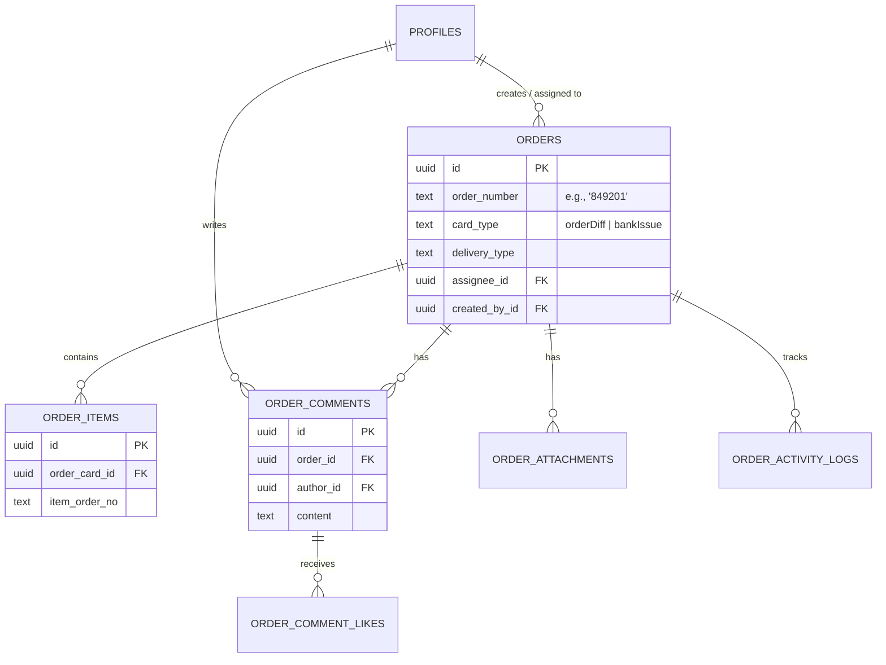

# Order & Order Bank Issue - Supabase Database Schema Design

เอกสารฉบับนี้คือการออกแบบ Schema Database สำหรับระบบ Order และ Order Bank Issue เพื่อเตรียมความพร้อมในการย้ายจาก Mock Data เป็น Real Mode โดยอ้างอิงโครงสร้างจากระบบ Case ปัจจุบัน

## 1. Final Database Schema (Mapping)

การแมปโครงสร้าง Dart Model กับตาราง Database

| Dart Model (`app_models.dart`) | Supabase Table | Field Mapping Notes |
|--------------------------------|----------------|----------------------|
| `OrderModel` | `orders` | `id` (ใน Dart) จะดึงจาก `order_number` แทน UUID เพื่อการแสดงผลที่คุ้นเคย ส่วนความสัมพันธ์จะใช้ `id` แบบ UUID ของตาราง |
| `OrderItemModel` | `order_items` | `id` (ใน Dart) ดึงจาก `item_order_no` |
| `CommentModel` | `order_comments` | โครงสร้างถอดแบบจาก `case_comments` ชี้ไปที่ `orders` |
| `FileAttachmentModel` | `order_attachments` | โครงสร้างถอดแบบจาก `case_attachments` ชี้ไปที่ `orders` |
| `ActivityLogModel` | `order_activity_logs`| โครงสร้างถอดแบบจาก `case_activity_logs` ชี้ไปที่ `orders` |

## 2. Entity-Relationship (ER) Diagram



## 3. SQL: CREATE TABLES & FOREIGN KEYS

```sql
-- 1. ORDERS TABLE
CREATE TABLE IF NOT EXISTS public.orders (
    id UUID PRIMARY KEY DEFAULT gen_random_uuid(),
    order_number TEXT NOT NULL,
    card_type TEXT NOT NULL CHECK (card_type IN ('orderDiff', 'bankIssue')),
    delivery_type TEXT,
    priority TEXT,
    activity_status TEXT DEFAULT 'newOrder',
    assignee_id UUID REFERENCES public.profiles(id) ON DELETE SET NULL,
    created_by_id UUID REFERENCES public.profiles(id) ON DELETE SET NULL,
    date_text TEXT,
    standard_date DATE,
    import_file TEXT,
    error_details TEXT,
    bank_code TEXT,
    bank_name TEXT,
    payment_method_code TEXT,
    payment_method TEXT,
    amount NUMERIC,
    status_order TEXT,
    created_at TIMESTAMPTZ DEFAULT NOW(),
    updated_at TIMESTAMPTZ DEFAULT NOW()
);

-- 2. ORDER ITEMS TABLE (สำหรับ Order Card ที่มีหลาย Order ภายใน)
CREATE TABLE IF NOT EXISTS public.order_items (
    id UUID PRIMARY KEY DEFAULT gen_random_uuid(),
    order_card_id UUID NOT NULL REFERENCES public.orders(id) ON DELETE CASCADE,
    item_order_no TEXT NOT NULL,
    delivery_type TEXT,
    created_at TIMESTAMPTZ DEFAULT NOW(),
    updated_at TIMESTAMPTZ DEFAULT NOW()
);

-- 3. ORDER COMMENTS TABLE
CREATE TABLE IF NOT EXISTS public.order_comments (
    id UUID PRIMARY KEY DEFAULT gen_random_uuid(),
    order_id UUID NOT NULL REFERENCES public.orders(id) ON DELETE CASCADE,
    author_id UUID NOT NULL REFERENCES public.profiles(id) ON DELETE SET NULL,
    content TEXT,
    attached_image_path TEXT,
    created_at TIMESTAMPTZ DEFAULT NOW(),
    updated_at TIMESTAMPTZ DEFAULT NOW()
);

-- 4. ORDER COMMENT LIKES (รองรับความสามารถเดียวกันกับ Case)
CREATE TABLE IF NOT EXISTS public.order_comment_likes (
    comment_id UUID NOT NULL REFERENCES public.order_comments(id) ON DELETE CASCADE,
    user_id UUID NOT NULL REFERENCES public.profiles(id) ON DELETE CASCADE,
    created_at TIMESTAMPTZ DEFAULT NOW(),
    PRIMARY KEY (comment_id, user_id)
);

-- 5. ORDER ATTACHMENTS
CREATE TABLE IF NOT EXISTS public.order_attachments (
    id UUID PRIMARY KEY DEFAULT gen_random_uuid(),
    order_id UUID NOT NULL REFERENCES public.orders(id) ON DELETE CASCADE,
    uploaded_by UUID REFERENCES public.profiles(id) ON DELETE SET NULL,
    file_name TEXT NOT NULL,
    file_size BIGINT,
    file_type TEXT,
    storage_path TEXT NOT NULL,
    created_at TIMESTAMPTZ DEFAULT NOW()
);

-- 6. ORDER ACTIVITY LOGS
CREATE TABLE IF NOT EXISTS public.order_activity_logs (
    id UUID PRIMARY KEY DEFAULT gen_random_uuid(),
    order_id UUID NOT NULL REFERENCES public.orders(id) ON DELETE CASCADE,
    author_id UUID REFERENCES public.profiles(id) ON DELETE SET NULL,
    title TEXT NOT NULL,
    icon TEXT,
    icon_color TEXT,
    icon_bg_color TEXT,
    created_at TIMESTAMPTZ DEFAULT NOW()
);
```

## 4. SQL: INDEXES

```sql
CREATE INDEX IF NOT EXISTS idx_orders_order_number ON public.orders(order_number);
CREATE INDEX IF NOT EXISTS idx_orders_card_type ON public.orders(card_type);
CREATE INDEX IF NOT EXISTS idx_orders_assignee_id ON public.orders(assignee_id);
CREATE INDEX IF NOT EXISTS idx_orders_created_by_id ON public.orders(created_by_id);
CREATE INDEX IF NOT EXISTS idx_order_items_order_card_id ON public.order_items(order_card_id);
CREATE INDEX IF NOT EXISTS idx_order_comments_order_id ON public.order_comments(order_id);
CREATE INDEX IF NOT EXISTS idx_order_attachments_order_id ON public.order_attachments(order_id);
CREATE INDEX IF NOT EXISTS idx_order_activity_logs_order_id ON public.order_activity_logs(order_id);
```

## 5. SQL: ROW LEVEL SECURITY (RLS) POLICIES

```sql
-- เปิดการใช้งาน RLS ทุกตาราง
ALTER TABLE public.orders ENABLE ROW LEVEL SECURITY;
ALTER TABLE public.order_items ENABLE ROW LEVEL SECURITY;
ALTER TABLE public.order_comments ENABLE ROW LEVEL SECURITY;
ALTER TABLE public.order_comment_likes ENABLE ROW LEVEL SECURITY;
ALTER TABLE public.order_attachments ENABLE ROW LEVEL SECURITY;
ALTER TABLE public.order_activity_logs ENABLE ROW LEVEL SECURITY;

-- ==============================================
-- POLICIES FOR 'orders'
-- ==============================================
-- SELECT: Admins/Leads/Devs see all. Users see only if they created or assigned.
CREATE POLICY "Users can view relevant orders" ON public.orders FOR SELECT USING (
    EXISTS (SELECT 1 FROM public.profiles WHERE profiles.id = auth.uid() AND profiles.role IN ('Admin', 'SysAdmin', 'Team Lead', 'Developer'))
    OR created_by_id = auth.uid()
    OR assignee_id = auth.uid()
);

-- INSERT: Authenticated users can create orders.
CREATE POLICY "Authenticated users can create orders" ON public.orders FOR INSERT WITH CHECK (auth.uid() IS NOT NULL);

-- UPDATE: Admins/Leads can update all. Devs can update all. Users only if assigned or creator.
CREATE POLICY "Users can update relevant orders" ON public.orders FOR UPDATE USING (
    EXISTS (SELECT 1 FROM public.profiles WHERE profiles.id = auth.uid() AND profiles.role IN ('Admin', 'SysAdmin', 'Team Lead', 'Developer'))
    OR created_by_id = auth.uid()
    OR assignee_id = auth.uid()
);

-- DELETE: Only Admins and Team Leads can delete.
CREATE POLICY "Admins and Leads can delete orders" ON public.orders FOR DELETE USING (
    EXISTS (SELECT 1 FROM public.profiles WHERE profiles.id = auth.uid() AND profiles.role IN ('Admin', 'SysAdmin', 'Team Lead'))
);

-- ==============================================
-- POLICIES FOR 'order_comments'
-- ==============================================
CREATE POLICY "Users can view comments on accessible orders" ON public.order_comments FOR SELECT USING (
    EXISTS (SELECT 1 FROM public.orders WHERE orders.id = order_comments.order_id)
);

CREATE POLICY "Authenticated users can add comments" ON public.order_comments FOR INSERT WITH CHECK (auth.uid() = author_id);

CREATE POLICY "Authors or admins can update comments" ON public.order_comments FOR UPDATE USING (
    auth.uid() = author_id OR EXISTS (SELECT 1 FROM public.profiles WHERE profiles.id = auth.uid() AND profiles.role IN ('Admin', 'SysAdmin'))
);

CREATE POLICY "Authors or admins can delete comments" ON public.order_comments FOR DELETE USING (
    auth.uid() = author_id OR EXISTS (SELECT 1 FROM public.profiles WHERE profiles.id = auth.uid() AND profiles.role IN ('Admin', 'SysAdmin'))
);

-- (Policies อื่นๆ ของ Items, Attachments, Activity logs จะอิงจากสิทธิ์การมองเห็น Order (SELECT) และสิทธิ์การเขียนสำหรับผู้อัปโหลด หรือ Admin)
```

## 6. SQL: STORAGE POLICIES

```sql
-- สร้าง Bucket ใหม่ (ถ้ายังไม่มี)
INSERT INTO storage.buckets (id, name, public) VALUES ('order-attachments', 'order-attachments', false) ON CONFLICT (id) DO NOTHING;

-- RLS for Storage (order-attachments)
CREATE POLICY "Authenticated users can view order attachments"
ON storage.objects FOR SELECT
USING (bucket_id = 'order-attachments' AND auth.role() = 'authenticated');

CREATE POLICY "Authenticated users can upload order attachments"
ON storage.objects FOR INSERT
WITH CHECK (bucket_id = 'order-attachments' AND auth.role() = 'authenticated');

CREATE POLICY "Uploaders or admins can delete order attachments"
ON storage.objects FOR DELETE
USING (bucket_id = 'order-attachments' AND (auth.uid() = owner OR EXISTS (SELECT 1 FROM public.profiles WHERE profiles.id = auth.uid() AND profiles.role IN ('Admin', 'SysAdmin'))));
```

## 7. Migration & Rollback Plan

### Migration (Up)
1. ตรวจสอบว่าระบบมีตาราง `orders` หรือยัง เพื่อป้องกันการชนกับระบบอื่น
2. รันคำสั่ง `CREATE TABLE` ตามลำดับ (Orders -> Items -> Comments -> Attachments -> Logs -> Likes)
3. รันคำสั่ง `CREATE INDEX`
4. ตั้งค่า RLS และสร้าง Storage Bucket

### Rollback (Down)
```sql
DROP TABLE IF EXISTS public.order_comment_likes CASCADE;
DROP TABLE IF EXISTS public.order_comments CASCADE;
DROP TABLE IF EXISTS public.order_attachments CASCADE;
DROP TABLE IF EXISTS public.order_activity_logs CASCADE;
DROP TABLE IF EXISTS public.order_items CASCADE;
DROP TABLE IF EXISTS public.orders CASCADE;
-- ไม่แนะนำให้ DROP Bucket เพื่อป้องกันไฟล์สูญหายโดยไม่ตั้งใจ
```