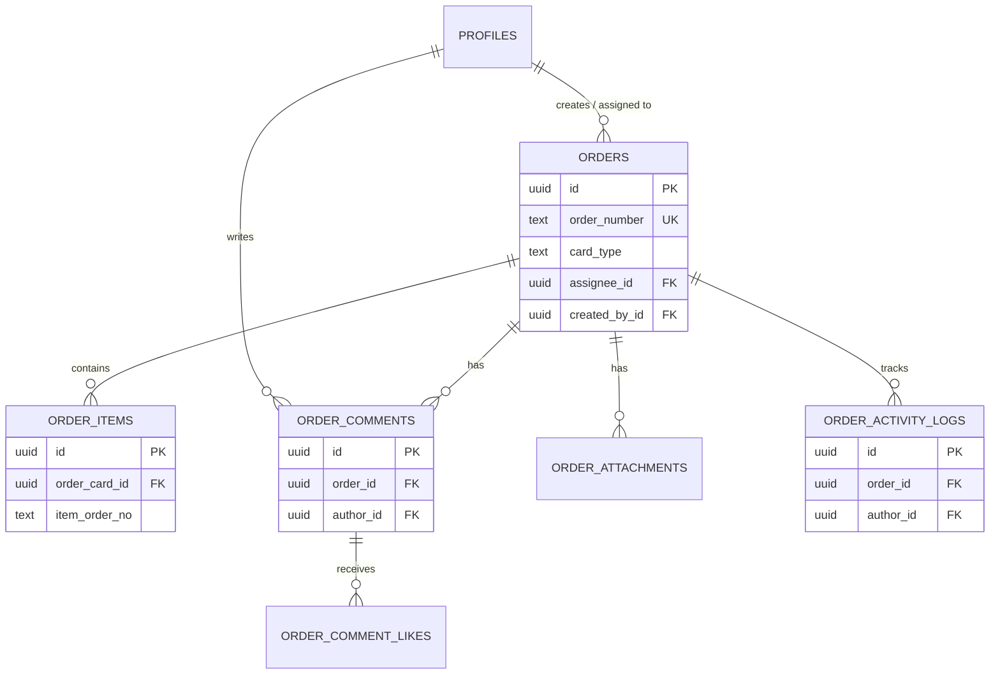

# Order & Order Bank Issue - Database Schema & Security Audit Report (Version 2.1)

เอกสารฉบับนี้รวบรวมข้อกำหนดการออกแบบ (Database Specification) และการวิเคราะห์ด้านความปลอดภัยสำหรับตารางกลุ่ม **Order** เพื่อให้สอดคล้องกับมาตรฐานของระบบแบบ Real Mode และสามารถใช้เป็นคู่มือสำหรับการทำ Migration จริงในอนาคต

---

## 1. Dart Model ↔ Database Mapping (Corrected)

| Dart Model (`app_models.dart`) | Supabase Table | Constraint & Field Mapping Notes |
|:---|:---|:---|
| `OrderModel.id` | `orders.id` | UUID (Primary Key) **ห้าม**ใช้ Display ID เป็นค่านี้ |
| `OrderModel.orderNumber` (ต้องเพิ่มใหม่) | `orders.order_number` | Text (UNIQUE, NOT NULL) สำหรับโชว์ใน UI |
| `OrderItemModel.id` | `order_items.id` | UUID (Primary Key) **ห้าม**ใช้ Display ID เป็นค่านี้ |
| `OrderItemModel.itemOrderNo` (ต้องเพิ่ม) | `order_items.item_order_no` | Text (NOT NULL) สำหรับโชว์ใน UI |
| `CommentModel.id` | `order_comments.id` | UUID |
| `FileAttachmentModel.id` | `order_attachments.id`| UUID |
| `ActivityLogModel.id` | `order_activity_logs.id`| UUID |

---

## 2. Foreign Key & ON DELETE Strategy (Data Integrity)

เราไม่อนุญาตให้ประวัติที่สำคัญสูญหายเมื่อโปรไฟล์พนักงานถูกลบ ดังนั้น นโยบายของ FK จะต้องเป็นไปตามนี้:

| ตารางต้นทาง | Foreign Key | อ้างอิงถึง (Table) | ON DELETE Strategy | เหตุผล & ผลกระทบ |
|:---|:---|:---|:---|:---|
| `orders` | `assignee_id` | `profiles.id` | `SET NULL` | หากลบผู้รับผิดชอบ, ออเดอร์จะกลายเป็นสถานะ "Unassigned" แต่ประวัติออเดอร์ยังอยู่ |
| `orders` | `created_by_id` | `profiles.id` | `RESTRICT` | **ห้ามลบ User** ถ้าเขาเคยสร้าง Order ไว้ เพื่อป้องกันไม่ให้ไม่มีผู้รับผิดชอบงานทางประวัติ |
| `order_items` | `order_card_id` | `orders.id` | `CASCADE` | ถ้า Order Card โดนลบ, สินค้าย่อยต้องถูกลบตามเพราะเป็นชิ้นส่วนเดียวกัน |
| `order_comments` | `order_id` | `orders.id` | `CASCADE` | ถ้า Order หาย, Comment ทั้งหมดของ Order นั้นจะถูกลบ |
| `order_comments` | `author_id` | `profiles.id` | `RESTRICT` | ห้ามลบคนพิมพ์ Comment ถ้าพิมพ์ไปแล้ว |
| `order_attachments`| `order_id` | `orders.id` | `CASCADE` | ลบไฟล์แนบออกจาก DB ถ้ายกเลิก/ลบออเดอร์ |
| `order_attachments`| `uploaded_by` | `profiles.id` | `SET NULL` | ลบ User ออกแล้วยังคงเก็บไฟล์ไว้ตรวจสอบย้อนหลังได้ |
| `order_activity_logs`| `order_id` | `orders.id` | `CASCADE` | (แต่แนะให้ทำ Soft Delete ให้ Orders แม่แทน เพื่อรักษา Log ไว้) |
| `order_activity_logs`| `author_id` | `profiles.id` | `SET NULL` | Log ยังอยู่ แต่ชี้ไปที่ค่า Null (แสดงคำว่า Unknown) |

---

## 3. Revised ER Diagram



---

## 4. Complete SQL Schema & Constraints

```sql
-- ฟังก์ชันสำหรับอัปเดต updated_at อัตโนมัติ
CREATE OR REPLACE FUNCTION update_updated_at_column()
RETURNS TRIGGER AS $$
BEGIN
    NEW.updated_at = NOW();
    RETURN NEW;
END;
$$ language 'plpgsql';

CREATE TABLE IF NOT EXISTS public.orders (
    id UUID PRIMARY KEY DEFAULT gen_random_uuid(),
    order_number TEXT NOT NULL UNIQUE,
    card_type TEXT NOT NULL CHECK (card_type IN ('orderDiff', 'bankIssue')),
    delivery_type TEXT,
    priority TEXT,
    activity_status TEXT DEFAULT 'newOrder',
    assignee_id UUID REFERENCES public.profiles(id) ON DELETE SET NULL,
    created_by_id UUID NOT NULL REFERENCES public.profiles(id) ON DELETE RESTRICT,
    date_text TEXT,
    standard_date DATE,
    import_file TEXT,
    error_details TEXT,
    bank_code TEXT,
    bank_name TEXT,
    payment_method_code TEXT,
    payment_method TEXT,
    amount NUMERIC CHECK (amount >= 0),
    status_order TEXT,
    created_at TIMESTAMPTZ DEFAULT NOW(),
    updated_at TIMESTAMPTZ DEFAULT NOW()
);

CREATE TRIGGER update_orders_updated_at
BEFORE UPDATE ON public.orders
FOR EACH ROW EXECUTE FUNCTION update_updated_at_column();

-- ตารางย่อย...
CREATE TABLE IF NOT EXISTS public.order_items (
    id UUID PRIMARY KEY DEFAULT gen_random_uuid(),
    order_card_id UUID NOT NULL REFERENCES public.orders(id) ON DELETE CASCADE,
    item_order_no TEXT NOT NULL,
    delivery_type TEXT,
    created_at TIMESTAMPTZ DEFAULT NOW(),
    updated_at TIMESTAMPTZ DEFAULT NOW()
);

CREATE TABLE IF NOT EXISTS public.order_comments (
    id UUID PRIMARY KEY DEFAULT gen_random_uuid(),
    order_id UUID NOT NULL REFERENCES public.orders(id) ON DELETE CASCADE,
    author_id UUID NOT NULL REFERENCES public.profiles(id) ON DELETE RESTRICT,
    content TEXT NOT NULL,
    attached_image_path TEXT,
    created_at TIMESTAMPTZ DEFAULT NOW(),
    updated_at TIMESTAMPTZ DEFAULT NOW()
);

CREATE TABLE IF NOT EXISTS public.order_comment_likes (
    comment_id UUID NOT NULL REFERENCES public.order_comments(id) ON DELETE CASCADE,
    user_id UUID NOT NULL REFERENCES public.profiles(id) ON DELETE CASCADE,
    created_at TIMESTAMPTZ DEFAULT NOW(),
    PRIMARY KEY (comment_id, user_id)
);

CREATE TABLE IF NOT EXISTS public.order_attachments (
    id UUID PRIMARY KEY DEFAULT gen_random_uuid(),
    order_id UUID NOT NULL REFERENCES public.orders(id) ON DELETE CASCADE,
    uploaded_by UUID REFERENCES public.profiles(id) ON DELETE SET NULL,
    file_name TEXT NOT NULL,
    file_size BIGINT,
    file_type TEXT,
    storage_path TEXT NOT NULL,
    created_at TIMESTAMPTZ DEFAULT NOW()
);

CREATE TABLE IF NOT EXISTS public.order_activity_logs (
    id UUID PRIMARY KEY DEFAULT gen_random_uuid(),
    order_id UUID NOT NULL REFERENCES public.orders(id) ON DELETE CASCADE,
    author_id UUID REFERENCES public.profiles(id) ON DELETE SET NULL,
    title TEXT NOT NULL,
    icon TEXT,
    icon_color TEXT,
    icon_bg_color TEXT,
    created_at TIMESTAMPTZ DEFAULT NOW()
);
```

---

## 5. RLS Policies & Security (Full Control)

เราสร้างฟังก์ชันเช็ค Role (Security Definer) เพื่อป้องกัน Recursive Query:
```sql
CREATE OR REPLACE FUNCTION get_user_role(check_uid UUID)
RETURNS TEXT
LANGUAGE sql
SECURITY DEFINER
SET search_path = public
AS $$
  SELECT role FROM public.profiles WHERE id = check_uid;
$$;
```

### 5.1 Orders RLS
```sql
ALTER TABLE public.orders ENABLE ROW LEVEL SECURITY;

-- SELECT: เห็นเฉพาะคนที่ Assign ให้ตัวเอง, ตัวเองสร้าง, หรือเป็น Admin/TeamLead/Developer
CREATE POLICY "Select orders" ON public.orders FOR SELECT
USING (
    get_user_role(auth.uid()) IN ('Admin', 'SysAdmin', 'Team Lead', 'Developer')
    OR created_by_id = auth.uid()
    OR assignee_id = auth.uid()
);

-- INSERT: บังคับให้ created_by_id เป็นของคนที่กดสร้าง
CREATE POLICY "Insert orders" ON public.orders FOR INSERT
WITH CHECK (
    auth.uid() = created_by_id
);

-- UPDATE: ห้ามเปลี่ยน id, order_number, card_type, created_by_id แอบเนียน
CREATE POLICY "Update orders" ON public.orders FOR UPDATE
USING (
    get_user_role(auth.uid()) IN ('Admin', 'SysAdmin', 'Team Lead', 'Developer')
    OR created_by_id = auth.uid()
    OR assignee_id = auth.uid()
)
WITH CHECK (
    -- การบังคับ Field Level Security
    id = id_old
    AND order_number = order_number_old
    AND card_type = card_type_old
    AND created_by_id = created_by_id_old
);

-- DELETE: Team Lead และ Admin เท่านั้น
CREATE POLICY "Delete orders" ON public.orders FOR DELETE
USING (
    get_user_role(auth.uid()) IN ('Admin', 'SysAdmin', 'Team Lead')
);
```

### 5.2 Child Tables RLS (Comments, Items)
ทุก Child Table ต้องอิงสิทธิ์จากตารางแม่ ป้องกันการแอบใส่ `order_id` ปลอม

```sql
-- Comments: โพสต์ได้เฉพาะออเดอร์ที่ตัวเองมีสิทธิ์อ่าน
CREATE POLICY "Insert comment" ON public.order_comments FOR INSERT
WITH CHECK (
    auth.uid() = author_id
    AND EXISTS (SELECT 1 FROM public.orders WHERE id = order_id)
);

-- Comments: อัปเดตเฉพาะอันที่ตัวเองพิมพ์ และห้ามเปลี่ยนคนพิมพ์
CREATE POLICY "Update comment" ON public.order_comments FOR UPDATE
USING (
    auth.uid() = author_id OR get_user_role(auth.uid()) IN ('Admin', 'SysAdmin')
)
WITH CHECK (
    author_id = author_id_old
    AND order_id = order_id_old
);
```

### 5.3 Activity Logs (Append Only)
```sql
ALTER TABLE public.order_activity_logs ENABLE ROW LEVEL SECURITY;

-- อ่านได้ถ้าเข้าถึง Order แม่ได้
CREATE POLICY "Select logs" ON public.order_activity_logs FOR SELECT
USING (EXISTS (SELECT 1 FROM public.orders WHERE id = order_id));

-- บันทึกได้ถ้า Author เป็นตัวเอง และเข้าถึง Order ได้
CREATE POLICY "Insert logs" ON public.order_activity_logs FOR INSERT
WITH CHECK (
    auth.uid() = author_id
    AND EXISTS (SELECT 1 FROM public.orders WHERE id = order_id)
);

-- ห้าม UPDATE และ DELETE สำหรับ Activity Logs โดยเด็ดขาด
-- (ไม่ต้องสร้าง Policy จะเท่ากับ Denied All โดยอัตโนมัติ)
```

---

## 6. Storage Security (Private Bucket)

สร้าง Bucket: `order-attachments` แบบ Private (ไม่มี Public Access)
เราใช้การตั้งชื่อไฟล์แบบ Path Convention: `order-attachments/{order_uuid}/...` เพื่อดึง Order ID ไปเช็ค Policy

```sql
-- SELECT: อ่านไฟล์ได้ถ้ามีสิทธิ์เห็น Order แม่
CREATE POLICY "Download order attachments" ON storage.objects FOR SELECT
USING (
    bucket_id = 'order-attachments'
    AND auth.role() = 'authenticated'
    AND EXISTS (
        SELECT 1 FROM public.orders
        WHERE id::text = (string_to_array(name, '/'))[1]
    )
);

-- INSERT: อัปโหลดได้
CREATE POLICY "Upload order attachments" ON storage.objects FOR INSERT
WITH CHECK (
    bucket_id = 'order-attachments'
    AND auth.role() = 'authenticated'
    AND EXISTS (
        SELECT 1 FROM public.orders
        WHERE id::text = (string_to_array(name, '/'))[1]
    )
);

-- DELETE: ลบไฟล์ได้เฉพาะคนที่อัปโหลด หรือ Admin
CREATE POLICY "Delete order attachments" ON storage.objects FOR DELETE
USING (
    bucket_id = 'order-attachments'
    AND (
        owner = auth.uid() OR get_user_role(auth.uid()) IN ('Admin', 'SysAdmin')
    )
);
```

---

## 7. Migration & Rollback Plan

**Migration (Up)**
- ตรวจสอบ `IF NOT EXISTS` ทุกครั้ง
- เรียงลำดับ: Functions -> Tables (Parent -> Child) -> Triggers -> RLS

**Rollback (Down)**
- เนื่องจากตารางมีความเชื่อมโยง FK เยอะ หากต้อง Rollback โดยรักษาข้อมูลเอาไว้ จะไม่สามารถใช้ `DROP TABLE CASCADE` แบบสุ่มสี่สุ่มห้าได้
- **ข้อเสนอแนะ**: ให้ DROP ทิ้งเฉพาะ `order_comment_likes`, `order_activity_logs` ก่อน จากนั้นไล่ลำดับถอยหลัง ห้าม DROP ตารางที่พ่วงอยู่กับระบบอื่น หรือทำการลบแค่ Policy เป็นรายตัว

---

## 8. Security Audit Checklist
- [x] แก้ไข UUID Primary Key ทั้งหมดไม่ใช้ Display ID
- [x] ตรวจสอบ `ON DELETE` FK ควบคุมประวัติ
- [x] ตรวจสอบ Security Definer เพื่อกัน RLS Recursion
- [x] Activity Logs เป็น Append-Only (ไม่มี Update/Delete)
- [x] ป้องกันการ Update ฟิลด์สำคัญอย่าง `created_by_id`, `card_type` ของ Order (ด้วย `WITH CHECK`)
- [x] ตรวจสอบ `Path Convention` ใน Storage Policies
- [x] กำหนด Unique Constraints และ Data Check อย่างรัดกุม